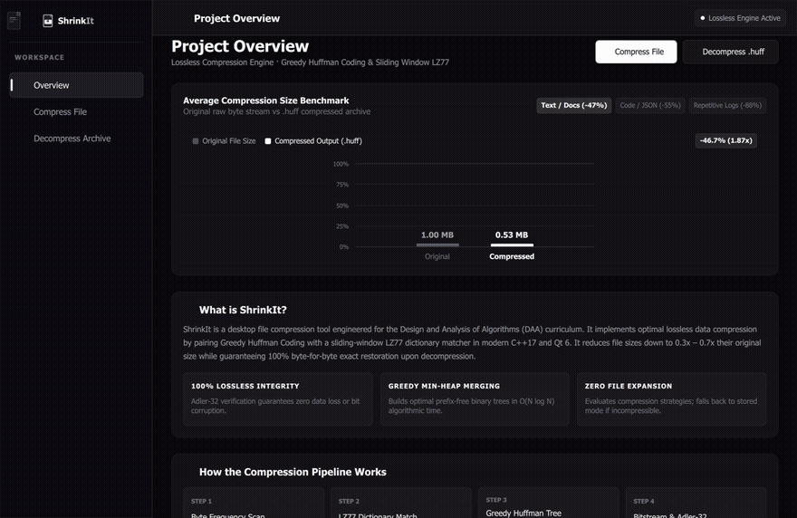
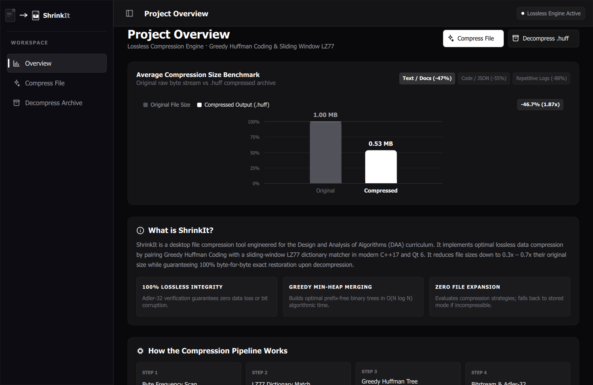
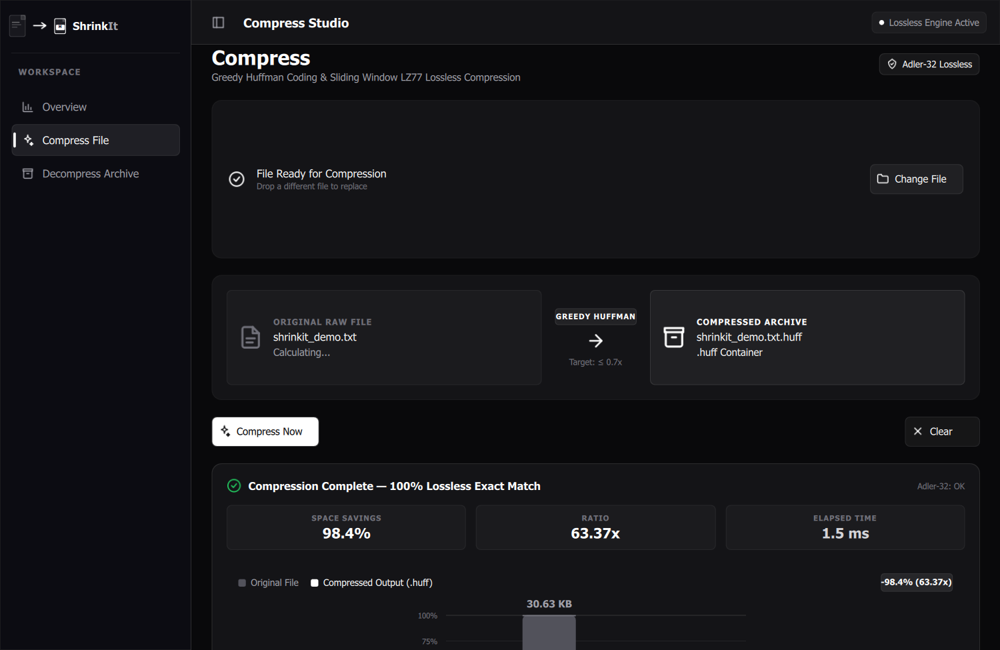
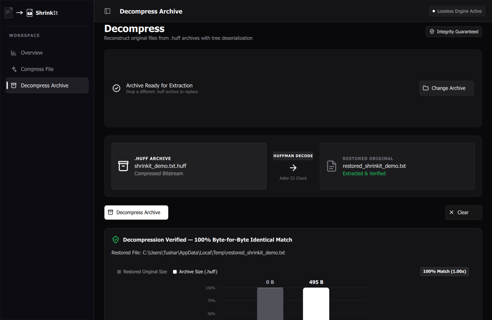

# ShrinkIt — Lossless Data Compression Studio

<div align="center">

[](https://isocpp.org/)
[](https://www.qt.io/)
[](https://cmake.org/)
[](src/tests/)
[](LICENSE)

### **Modern Lossless File Compression Engine with Custom Binary Bitstream & Cartesian Analytics**
*Designed and built for Design and Analysis of Algorithms (DAA).*

**Author:** [Tushar Mali](https://github.com/Action-kamen257)  
**Status:** 🚀 **Production-Ready Desktop Application**

<br/>

<a href="images/shrinkit_walkthrough.mp4">
  
</a>

<p align="center">
  <i>📹 <b>Interactive GUI Walkthrough</b>: Navigating Overview, Compression, and Decompression with dynamic size comparison graphs.</i><br/>
  <a href="images/shrinkit_walkthrough.mp4">▶️ <b>Watch Full Video (MP4)</b></a>
</p>

</div>

---

## 1. Project Overview

ShrinkIt is a desktop application for lossless data compression, implementing:
1. **Greedy Huffman Coding**: Frequency-sorted binary tree via a custom min-heap priority queue ($O(N \log N)$ complexity).
2. **LZ77 Pre-pass**: Sliding window dictionary compression to reduce repetitive patterns before bit-level prefix coding.
3. **Custom .huff Binary Container**: Big-endian variable-length bit packing with Adler-32 checksum integrity verification.
4. **Adaptive Stored Fallback**: Protects high-entropy inputs (e.g. encrypted or pre-compressed data) from negative expansion.

---

## 2. User Interface & Screenshots

The application interface is styled with a graphite-dark palette, Cartesian comparison charts, and clean navigation:

| Screen | Description |
|:---:|:---|
|  | **Overview View**<br/>Displays project architecture, algorithmic breakdown, and size comparison metrics. |
|  | **Compression View**<br/>Input file selection, live throughput progress, compression ratio, and size delta graph. |
|  | **Decompression View**<br/>Archive extraction, checksum verification, and integrity validation. |

---

## 3. Algorithmic Foundation

### Huffman Coding & Prefix-Free Tree
Huffman coding constructs an optimal prefix code for a given alphabet using a greedy strategy:
- Characters with higher frequencies receive shorter variable-length bit codes.
- No code is a prefix of another, enabling deterministic decoding without delimiters.
- Theoretical limit bounded by Shannon Entropy:
  $$\mathcal{H}(X) = - \sum_{i=1}^n P(x_i) \log_2 P(x_i)$$

### Min-Heap Priority Queue
The tree is assembled bottom-up:
1. Initialize a min-heap where each unique byte forms an isolated leaf node.
2. Extract the two nodes with the lowest frequencies.
3. Create an internal parent node with frequency equal to the sum of the children.
4. Insert the parent back into the min-heap.
5. Repeat until a single root node remains.

---

## 4. Project Structure

```
shrinkit/
├── CMakeLists.txt              # Primary CMake configuration
├── PSEUDOCODE.txt              # Detailed algorithm pseudocode with analysis
├── README.md                   # Project documentation
├── images/                     # UI screenshots and demo recording
│   ├── overview_screen.png
│   ├── compress_screen.png
│   ├── decompress_screen.png
│   ├── shrinkit_walkthrough.gif
│   └── shrinkit_walkthrough.mp4
├── scripts/                    # Build and tool scripts
│   ├── build_msvc.bat
│   └── generate_app_icon.py
└── src/
    ├── core/                   # Pure C++17 compression engine
    │   ├── BitStream.h/.cpp    # Bit-level I/O streams
    │   ├── Checksum.h          # Adler-32 integrity validation
    │   ├── FileFormat.h        # .huff file header specifications
    │   ├── HuffmanCompressor.h/.cpp # Compression coordinator
    │   ├── HuffmanNode.h       # Tree node representation
    │   ├── HuffmanTree.h/.cpp  # Huffman tree builder
    │   ├── LZ77.h              # Sliding-window LZ77 encoder/decoder
    │   └── MinHeap.h           # Array-based binary min-heap
    ├── qt_bridge/              # Asynchronous Qt worker & models
    ├── ui/                     # QML views and graphite styling
    └── tests/                  # Unit tests (Catch2)
```

---

## 5. Building & Running Locally

### Prerequisites
- C++17 compliant compiler (MSVC 2019/2022, GCC 11+, or Clang 13+)
- CMake 3.20 or newer
- Qt 6.5+ (Qt Quick, QML, Core, Gui)

### Build Steps

```powershell
# Clone the repository
git clone https://github.com/Action-kamen257/shrinkit-lossless-compression.git
cd shrinkit-lossless-compression

# Configure with CMake
cmake -B build -S . -DCMAKE_BUILD_TYPE=Release

# Compile
cmake --build build --config Release
```

### Running Tests
The test suite validates heap properties, bit streams, Adler-32 verification, and compression round-trips:
```powershell
./build/bin/shrinkit_tests.exe
```

---

## 6. License & Credits

Distributed under the MIT License. See [LICENSE](LICENSE) for details.

Developed by **[Tushar Mali](https://github.com/Action-kamen257)**.
